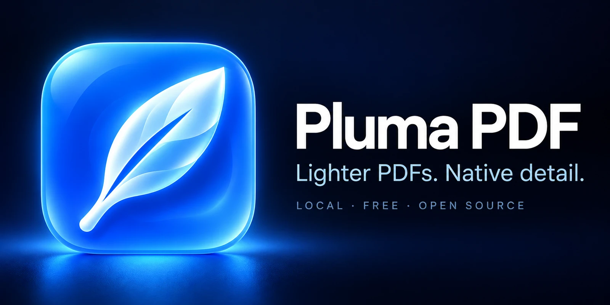
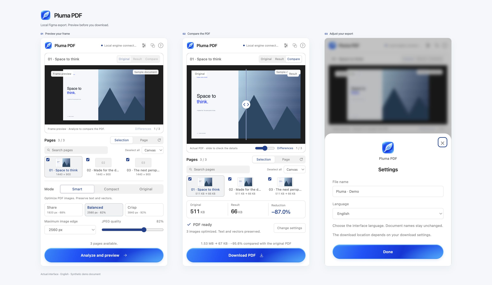

<p align="center"></p>

<p align="center">
  <a href="https://github.com/charliezstong/pluma-pdf/releases/latest">Download</a> ·
  <a href="docs/INSTALL.md">Installation guide</a> ·
  <a href="docs/ARCHITECTURE.md">How it works</a> ·
  <a href="docs/CONTRIBUTING.md">Contributing</a>
</p>

**Pluma PDF** exports lighter PDFs from Figma by optimizing embedded images while preserving native text and vectors. Review each page, compare the original and optimized PDF, and download the complete document. Processing stays on your computer.

Free and open source, with no subscription. Pluma runs as a development plugin in **Figma Desktop**, with an optional local Node.js engine. The repository, documentation and installation tools are in English. The plugin detects English, Spanish and Portuguese from your preferred language settings. Unsupported languages fall back to English; you can override the choice in the plugin settings.

## Install

1. Install **[Node.js 24 LTS](https://nodejs.org/)**, which includes npm.
2. Download `PlumaPDF-1.3.0.zip` from the [latest release](https://github.com/charliezstong/pluma-pdf/releases/latest), extract it and keep the entire folder.
3. Run the installer for your operating system:

| Platform | Install | Start the local engine |
| --- | --- | --- |
| macOS | `scripts/macos/install.command` | `scripts/macos/start-engine.command` |
| Windows | `scripts/windows/install.cmd` | `scripts/windows/start-engine.cmd` |

4. In **Figma Desktop**, open a design file and choose **Plugins → Development → Import plugin from manifest…**. Select `manifest.json` at the extracted folder's root.
5. Start the engine, leave its window open, and run **Pluma PDF — Export & Compress** from Development.

The first installation downloads dependencies. If macOS blocks a downloaded launcher, use the Terminal alternative in the [installation guide](docs/INSTALL.md). The Smart mode needs the engine running; Original and Compact can export without it. Pluma PDF — Export & Compress has been submitted to [Figma Community](https://www.figma.com/community/plugin/1697169100357342944) and is awaiting review; public availability depends on Figma's approval. The packaged development installation remains available using the steps above.

The installable release ZIP includes prebuilt `dist/code.js` and `dist/ui.html`. Git checkouts and GitHub's automatic **Source code** downloads omit `dist/`; the installer builds it before you import the manifest. Keep the generated files in place while Figma uses the plugin.

## If Figma cannot load the plugin

The message **"An error occurred while loading the plugin environment"** can mean that the files referenced by `manifest.json` are missing, including after a source update removes generated bundles. From the plugin folder, run:

```sh
npm start
```

Startup checks the manifest entry points and rebuilds missing or invalid bundles before starting or reusing the local engine. Then reopen **Pluma PDF — Export & Compress** in Figma. If the folder moved, reimport its `manifest.json`.

To rebuild without starting the engine, run `npm run build`. If dependencies are missing, run `npm run install:local` first. `npm run doctor` checks the manifest's actual bundle files and reports an error when they are missing or invalid; it does not rebuild them or start a service. See the [recovery steps](docs/INSTALL.md#figmas-plugin-environment-error) for details.

## Use

<p align="center"></p>

These three English-language screens use the built-in synthetic document, rendered at twice the panel resolution. Its reduction figures do not predict savings for other files.

Select frames or choose **Page** to load the current page. The active frame appears immediately as a PNG preview, before analysis; this is a visual reference, not the optimized PDF. Review thumbnails and **Canvas / Name / Manual** ordering, select a quality profile, and click **Analyze and preview**. After reviewing the result, click **Download PDF**. Labels follow the detected or selected language.

- **Real comparison:** original and optimized PDF renders, a draggable slider, and a deterministic difference map.
- **Measured sizes:** before/after for each frame and a final size after merging and sharing equivalent resources.
- **Overlap review:** possible overlaps based on position, dimensions and coverage, with an action to locate each layer. It never removes layers.
- **Three languages:** automatic English, Spanish or Portuguese detection, with a saved override under **Settings → Language**.
- **Analysis feedback:** the preview follows the page being processed, with a subtle scan over the visible PDF. Processing is never delayed for the animation.
- **Vertical layout:** a 400 × 720 panel with a contained thumbnail strip.
- **Reanalysis:** change profiles using cached originals. Refresh after changing the Figma design to capture it again.

| Mode in the interface | Behavior |
| --- | --- |
| **Smart** | Optimizes supported embedded images and shares identical resources, preserving text and vectors. Requires the local engine. |
| **Original** | Merges native exports without recompressing their images. |
| **Compact** | Rasterizes each page, sacrificing selectable text and vector zoom. |

Profiles: **Share**, 1920 px / JPEG quality 68; **Balanced**, 2560 px / 82; **Crisp**, 3840 px / 92. These are image budgets, not guaranteed file sizes or print certifications.

## Quality and privacy

The engine processes exported bytes without editing the source Figma document. It resamples color and alpha together when supported, preserves unsupported masks and profiles, and deduplicates equivalent encoded resources without another JPEG pass.

JPEG is lossy. The comparison describes changes at the displayed resolution; review photographs, transparency and text before sharing or printing. Pluma does not provide general CMYK/P3 conversion or PDF/X certification.

PDFs stay on your computer. The engine listens only on loopback (`localhost:3847`) and processes data in memory. The initial dependency installation requires internet access. Public tests and screenshots use synthetic content. Read the [Privacy Policy](docs/PRIVACY.md) for local processing, saved language preferences, diagnostic output, and support practices.

Limits: 200 frames per job, 300 MiB per input PDF, 40 megapixels per image, two concurrent engine requests and a 450 MiB PDF cache in the interface.

## Development

```sh
npm ci
npm run check
npm start
```

`npm run check` typechecks, builds the plugin and runs the tests locally. `npm run preview` opens the browser demo server. `npm run package` builds an installable ZIP. GitHub Actions is disabled for this repository.

```text
assets/       Brand artwork and synthetic screenshots
src/          Figma controller, interface and PDF comparison
engine/       Local optimization, placement, masks and deduplication
scripts/      Build, preview, installation and packaging tools
  macos/      macOS launchers
  windows/    Windows launchers
docs/         Installation, architecture, brand and contributor guides
tests/        Synthetic fixtures and regression checks
dist/         Generated bundles; ignored by Git, included in release ZIPs
licenses/     Third-party license texts
```

Read [AGENTS.md](AGENTS.md) before changing the project. See [THIRD_PARTY_NOTICES.md](THIRD_PARTY_NOTICES.md) for dependencies and attribution.

## License

[MIT](LICENSE) · Created by [charliezstong](https://github.com/charliezstong).
