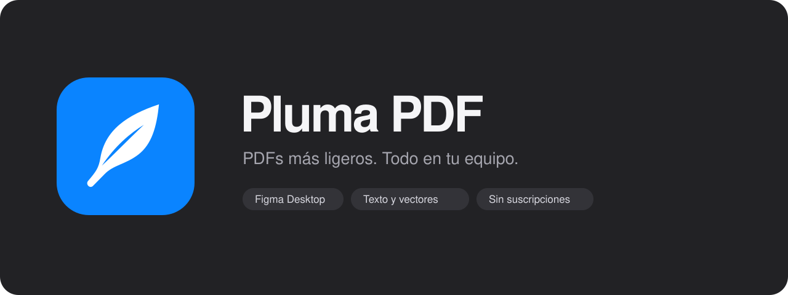

<p align="center"></p>

<p align="center">
  <a href="https://github.com/charliezstong/pluma-pdf/releases/latest">Descargar</a> ·
  <a href="docs/INSTALL.md">Instalación paso a paso</a> ·
  <a href="docs/ARCHITECTURE.md">Cómo funciona</a> ·
  <a href="docs/CONTRIBUTING.md">Contribuir</a>
</p>

**Pluma PDF** exporta PDFs de Figma y reduce el peso de sus imágenes conservando texto y vectores. Puedes revisar cada página, comparar el original y el resultado, y descargar el libro completo. El procesamiento ocurre en tu computador.

Gratis, sin suscripciones y con código abierto. Es un plugin de desarrollo para **Figma Desktop**, acompañado de un motor local. Todavía no se distribuye desde Figma Community.

## Instalar

1. Instala **[Node.js 24 LTS](https://nodejs.org/)**, que incluye npm.
2. Descarga **PlumaPDF-1.0.0.zip** desde la [última release](https://github.com/charliezstong/pluma-pdf/releases/latest), descomprímelo y conserva la carpeta completa.
3. Abre **Instalar Pluma PDF.command** en Mac o **Instalar Pluma PDF.cmd** en Windows. La primera instalación descarga las dependencias.
4. En **Figma Desktop**, abre un archivo y elige **Plugins → Development → Import plugin from manifest…**. Selecciona `manifest.json` de la carpeta.
5. Abre **Iniciar motor.command** o **Iniciar motor.cmd**, deja la ventana abierta y ejecuta **Pluma PDF · Local** desde Development.

En Mac, si Finder no permite abrir un lanzador descargado, usa la alternativa de Terminal descrita en la [guía de instalación](docs/INSTALL.md). No necesitas desactivar las protecciones del sistema.

**Importante:** el modo Inteligente necesita el motor local abierto. Original y Compacto pueden funcionar sin él. Los lanzadores de Windows están incluidos; las pruebas automatizadas no sustituyen una verificación manual dentro de Figma Desktop en ese sistema.

## Usar

<p align="center"></p>

La captura utiliza un documento de muestra generado con formas y texto; sus cifras de reducción no representan otros archivos.

Selecciona frames o elige **Página** para cargar los de la página actual. Revisa las miniaturas y el orden **Canvas / Nombre / Manual**, elige un perfil y pulsa **Analizar y previsualizar**. Después de revisar el resultado, pulsa **Descargar PDF**.

- **Comparación real.** Original, Resultado, deslizador y mapa de diferencias entre los PDFs renderizados.
- **Peso medido.** Antes/después por frame y tamaño final después de unir y compartir recursos repetidos.
- **Capas superpuestas.** Detecta posibles coincidencias por posición, tamaño y solapamiento. Los avisos permiten localizar cada capa en Figma para revisarla; no las elimina.
- **Interfaz vertical.** Panel de 460 × 800 con miniaturas que se desplazan dentro de su propia fila.
- **Reanálisis.** Cambia de perfil usando los originales en memoria. Pulsa ↻ después de editar el diseño para volver a leerlo.

| Modo | Resultado |
| --- | --- |
| **Inteligente** | Optimiza imágenes compatibles dentro del PDF y comparte recursos idénticos; conserva texto y vectores. Requiere el motor local. |
| **Original** | Une las exportaciones nativas sin recomprimir sus imágenes. |
| **Compacto** | Convierte cada página en una imagen; pierde texto seleccionable y zoom vectorial. |

Los perfiles son **Compartir: 1920 px / calidad 68**, **Equilibrado: 2560 px / 82** y **Nítido: 3840 px / 92**. Son presupuestos de píxeles y calidad JPEG, no promesas de reducción ni certificaciones de imprenta.

## Calidad y privacidad

El motor procesa los bytes exportados y no cambia capas ni imágenes del documento. Remuestrea color y alpha juntos cuando puede hacerlo de forma segura; conserva formatos, máscaras y perfiles no compatibles. La pasada final de deduplicación no vuelve a comprimir JPEG.

JPEG tiene pérdida. El comparador muestra cambios a la resolución indicada, no garantiza identidad a cualquier zoom. Revisa fotografías, transparencias y texto antes de compartir o imprimir un PDF.

Los PDFs no se envían a un servicio externo. El motor escucha solo en loopback (`localhost:3847`) y procesa los datos en memoria. La instalación inicial de paquetes sí necesita internet. Este repositorio contiene fixtures sintéticos; no incluye documentos ni capturas de clientes.

Límites del motor: 200 frames por trabajo, 300 MiB por PDF enviado, 40 megapíxeles por imagen y dos solicitudes simultáneas. La interfaz limita su caché PDF a 450 MiB. No hay conversión general CMYK/P3 ni certificación PDF/X.

## Desarrollo

```sh
npm ci
npm run check
npm run engine
```

`npm run check` comprueba tipos, construye `dist/` y ejecuta los tests. Para generar una distribución instalable, usa `npm run package`.

```text
src/          Controlador de Figma, interfaz y comparación visual
engine/       Optimización, máscaras, colocación y deduplicación PDF
scripts/      Instalación, inicio local y empaquetado
assets/brand/ Icono, marca y portada en SVG/PNG
docs/         Instalación, arquitectura y contribución
tests/        Casos sintéticos y regresiones
dist/         Bundles que importa Figma
```

Lee [AGENTS.md](AGENTS.md) antes de modificar el proyecto. Las dependencias y sus atribuciones están en [THIRD_PARTY_NOTICES.md](THIRD_PARTY_NOTICES.md).

## Licencia

[MIT](LICENSE) · Creado por [charliezstong](https://github.com/charliezstong).
