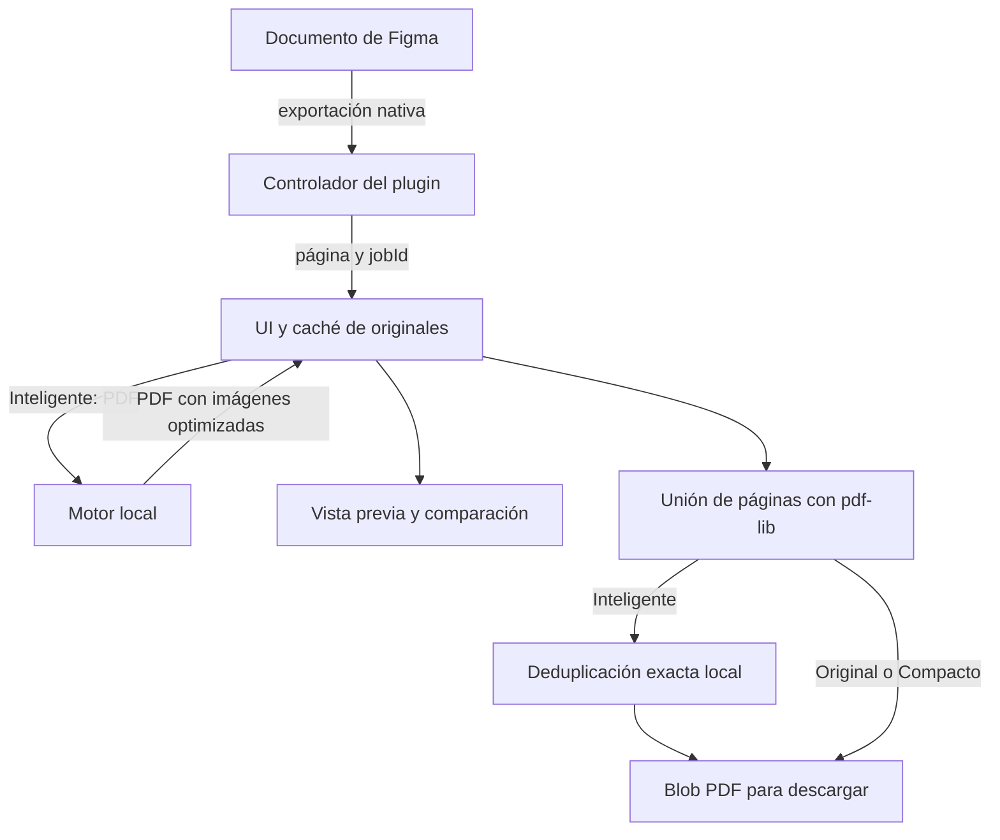

# Arquitectura de Pluma PDF

Pluma combina un plugin de Figma con un servicio Node opcional que procesa bytes en memoria. El diseño original no se utiliza como superficie de optimización: el punto de partida del modo Inteligente es su PDF nativo.

## Componentes

```text
manifest.json                 Entradas y acceso de red del plugin
build.mjs                     Bundles del controlador y de la UI
src/
  plugin.ts                   Controlador en el sandbox de Figma
  ui.ts / ui.html / ui.css     Panel vertical, caché y descarga
  geometry.ts                 Presupuestos de rasterización
  occlusion.ts                Diagnóstico conservador de capas
  pdf-preview.ts              Render de los bytes PDF reales
  visual-diff.ts              Comparación RGBA y mapa de diferencias
engine/
  server.mjs                  API HTTP en loopback
  optimize.mjs                Imágenes raster independientes
  pdf-optimize.mjs            Imágenes internas del PDF
  pdf-placement.mjs           Presupuesto por colocación real
  pdf-deduplicate.mjs         Recursos codificados equivalentes
tests/                        PDFs, píxeles y canvas sintéticos
docs/                         Documentación del software
assets/brand/                 Marca e imágenes públicas del producto
scripts/local.mjs             Instalación, diagnóstico y arranque portable
scripts/package.mjs           ZIP de release e inventario de archivos
.github/workflows/ci.yml       Verificación del repositorio en CI
licenses/                     Licencias de dependencias distribuidas
THIRD_PARTY_NOTICES.md         Avisos de terceros
preview.mjs                   Demo local del panel
dist/                         Salida generada; no es código fuente
```

Los lanzadores `.command` en macOS y `.cmd` en Windows utilizan el arranque portable. Los mismos servicios se pueden iniciar con los scripts de npm. No hay un backend remoto ni almacenamiento persistente de documentos en el motor.



## Límites entre entornos

El controlador usa la API de Figma y entrega bytes mediante mensajes al iframe. La UI utiliza APIs del navegador y no ejecuta procesos Node. El motor recibe cuerpos binarios HTTP; no recibe rutas del disco ni identificadores que le permitan editar Figma.

`src/plugin.ts` exporta directamente los nodos originales. El modo Original y el modo Inteligente solicitan PDF sRGB. Compacto solicita PNG sRGB y construye páginas rasterizadas en la UI: es una opción explícita, con un compromiso distinto respecto de texto y vectores.

La única acción que puede cambiar la navegación del editor es Foco: selecciona una capa solicitada y la muestra en el viewport. Exportar y diagnosticar no cambian el contenido, la visibilidad ni la jerarquía del documento.

## Exportación y estado

El alcance puede ser la selección o los elementos exportables de la página. El controlador expande secciones, evita duplicar ancestros y descendientes y ordena inicialmente por posición absoluta: arriba hacia abajo y después de izquierda a derecha. Los nombres y el orden de capas no determinan ese orden. La UI permite revisar la lista y elegir otros órdenes explícitos.

Cada trabajo tiene `jobId`. El controlador entrega una página y espera su ACK antes de exportar la siguiente. La cancelación rechaza esperas pendientes; respuestas antiguas no pueden avanzar un trabajo nuevo. Un cambio de página o el cierre del plugin cancela el trabajo correspondiente.

La UI conserva los originales y un número acotado de variantes por frame. El modo, la calidad y el límite de píxeles forman la clave de una variante; el orden y las páginas seleccionadas también forman parte de la validez del PDF final. Cambiar esos valores invalida una descarga obsoleta.

La caché de UI tiene un límite de 450 MiB y hasta dos variantes por frame. El controlador admite hasta 200 páginas. Son límites operativos, no una garantía de que un documento de cualquier complejidad quepa en memoria.

## Optimización de PDF

`pdf-optimize.mjs` carga el PDF con pdf-lib y modifica únicamente imágenes compatibles. Mantiene sus referencias cuando es posible; la deduplicación puede hacer que dos referencias equivalentes compartan el mismo objeto. No reescribe el texto ni las instrucciones vectoriales de las páginas.

El recorrido admite muestras RGB/Gray de 8 bits con DCT o Flate simple y perfiles sRGB reconocidos. Los recursos con color o decodificación no compatibles permanecen intactos. Esto incluye casos ambiguos de `/Decode`, `ColorTransform`, predictores, `/Matte` y máscaras complejas.

### Colocación

PDF.js inspecciona los operadores de todas las páginas y sus matrices para estimar cuántos píxeles necesita cada imagen según su tamaño visible. El presupuesto cubre ambos ejes y conserva la proporción de la fuente. Una imagen compartida debe satisfacer su mayor uso.

Los grupos, repeticiones o patrones que no pueden resolverse de forma segura bloquean el límite específico de ese recurso. Si falta cobertura de páginas, se alcanza el timeout o queda un uso sin resolver, se conserva el límite global. La auditoría del motor tiene un máximo de 30 segundos y no necesita renders de página completa.

La deduplicación también combina los presupuestos de sus alias. Si uno de sus usos es desconocido, el recurso compartido usa el límite global; un primer uso pequeño no puede degradar un uso posterior grande.

### Color y alpha

Sharp aplica el remuestreo con color y alpha juntos para evitar halos. El color se codifica como JPEG y la máscara como Flate sin pérdida después de redimensionarla. El motor conserva el perfil ICC del PDF y no aplica una autorrotación EXIF que altere la geometría del recurso.

Una máscara compartida recibe una nueva referencia para cada variante que lo necesite. Solo se retiran máscaras antiguas después de comprobar que ninguna estructura del PDF las referencia. Una máscara completamente blanca puede omitirse; una máscara parcialmente transparente no puede tratarse como opaca.

Los flujos Flate tienen un tamaño de salida acotado. Si falta su cierre pero se obtienen exactamente todas las muestras esperadas, se puede recuperar ese caso concreto. Los datos incompletos o incompatibles permanecen sin optimizar.

### Deduplicación final

Después de unir los frames, la UI puede enviar el PDF a `/pdf/deduplicate`. Esta operación compara bytes codificados y diccionarios equivalentes, incluidas las relaciones de máscara y perfil. Reescribe referencias a objetos equivalentes y retira los duplicados.

No decodifica fotos, no redimensiona ni vuelve a comprimir JPEG. Las vistas previas de las variantes siguen representando las mismas imágenes que el PDF unido. No se promete identidad binaria del archivo: cambian su serialización y sus referencias.

Todas las etapas conservan el original si el archivo completo resultante no es menor. Los recuentos de objetos almacenados, recursos de dibujo, imágenes optimizadas y páginas son métricas distintas.

## HTTP local

`server.mjs` escucha en `127.0.0.1:3847`. El Host debe corresponder a loopback y CORS admite Figma, `null` y orígenes localhost. POST requiere `X-Pluma-Client: 1`; OPTIONS maneja el preflight de acceso a red privada.

| Ruta | Función |
| --- | --- |
| `GET /health` | Descubrimiento del motor |
| `POST /image` | Optimización raster independiente |
| `POST /pdf` | Optimización de imágenes dentro de un PDF |
| `POST /pdf/deduplicate` | Unión de recursos idénticos, sin recompresión |

Las consultas son estrictas: claves desconocidas, repetidas o fuera de rango se rechazan. `/pdf` acepta calidad 40–100 y `maxEdge` 512–8192, con valores por defecto de 82 y 2400. Ese límite expresa píxeles, no DPI.

El motor acepta hasta 300 MiB por PDF, 40 MiB por imagen independiente y 40 millones de píxeles decodificados por imagen. Hay como máximo dos trabajos simultáneos. Sharp tiene un timeout de 20 segundos por operación y el recorrido de optimización un presupuesto de 90 segundos. Los errores HTTP son JSON estructurado; los resultados exponen tamaños y contadores mediante encabezados.

## Previsualización y diagnóstico

`pdf-preview.ts` renderiza los bytes exportados con PDF.js y su worker incluidos en el bundle. No utiliza una captura del canvas como sustituto del PDF ni descarga un worker desde un CDN. Libera las tareas y superficies de dibujo al terminar.

`visual-diff.ts` compara todos los bytes RGBA para la igualdad exacta. También calcula diferencias y un mapa amplificado; un umbral de reporte no convierte dos imágenes distintas en idénticas. Toda evaluación se limita a la resolución utilizada.

`occlusion.ts` inspecciona geometría, visibilidad, máscaras y evidencia de opacidad. La lectura de bytes JPEG del documento solo ocurre durante el diagnóstico solicitado. Las coincidencias posibles no se convierten automáticamente en cobertura verificada y el diagnóstico nunca oculta o elimina una capa.

## Build, pruebas y publicación

`npm run check` ejecuta typecheck, build y pruebas. Esbuild produce el controlador y la UI autocontenida. Las pruebas del controlador ejecutan el bundle real; las pruebas del motor generan PDFs y píxeles sintéticos. Una muestra privada puede usarse de forma opcional mediante `PLUMA_PDF_FIXTURE`, sin formar parte del repositorio.

El demo de `preview.mjs` sirve el panel en `127.0.0.1:3848` con datos sintéticos. Sirve para revisar interacción y layout, pero no demuestra integración con Figma ni calidad de un documento real.

`scripts/local.mjs` comprueba el entorno, instala desde el lockfile cuando corresponde y verifica la identidad del servicio antes de reutilizar un puerto ocupado. El nombre, el motor y la versión de `/health` deben concordar con el paquete. `scripts/package.mjs` utiliza una lista permitida de archivos, rechaza enlaces simbólicos y genera un ZIP con inventario y SHA-256; no incorpora dependencias instaladas ni documentos del usuario.

El repositorio público contiene software, documentación genérica y muestras sintéticas. Los documentos de validación, capturas, capas, coordenadas, identificadores, métricas y fingerprints privados permanecen fuera de su snapshot y de sus releases. Publicar código no cambia los permisos de esos documentos.
