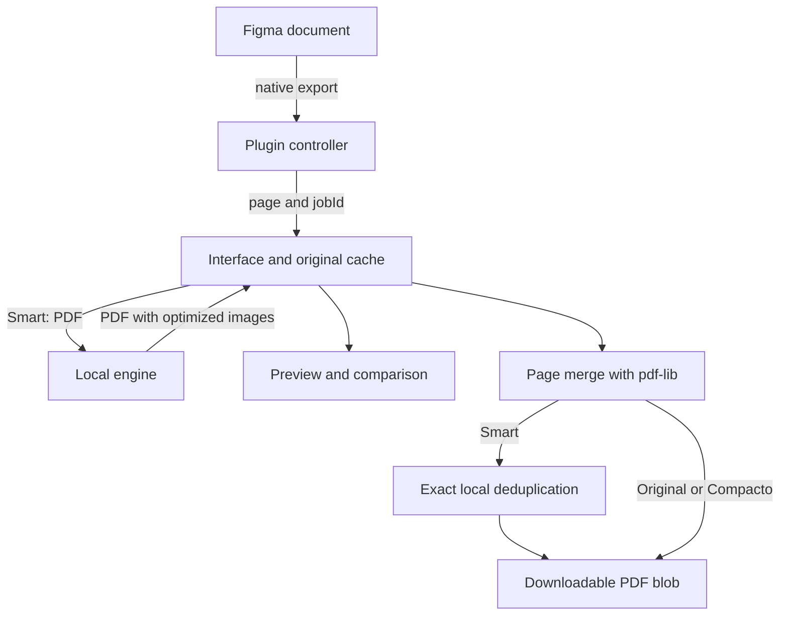

# Pluma PDF architecture

Pluma combines a Figma plugin with an optional Node service that processes bytes in memory. The **Smart** mode starts from the native PDF and optimizes its images while preserving the original design. This document describes the layout for release **1.1.0**. The product interface supports automatic English, Spanish and Portuguese detection, with a saved user override and English fallback.

## Components

The repository root contains project metadata and the main documentation. Build tools, the local demo, and platform launchers live under `scripts/`.

```text
PlumaPDF/
├── .gitignore                    Local and private file exclusions
├── AGENTS.md                     Contributor and agent invariants
├── README.md                     Product overview and quick start
├── LICENSE                       Project license
├── THIRD_PARTY_NOTICES.md         Third-party notices
├── manifest.json                 Plugin entry points and network access
├── package.json                  Commands and dependency requirements
├── package-lock.json             Locked dependency versions
├── tsconfig.json                 TypeScript configuration
├── assets/brand/                 Public product branding and demo images
├── dist/                         Generated locally; release ZIP only, ignored by Git
│   ├── code.js                   Figma controller bundle
│   └── ui.html                   Self-contained interface bundle
├── docs/                         Software documentation
├── engine/
│   ├── server.mjs                Loopback HTTP API
│   ├── optimize.mjs              Standalone raster images
│   ├── pdf-optimize.mjs          Images inside PDFs
│   ├── pdf-placement.mjs         Image budgets from actual placement
│   └── pdf-deduplicate.mjs       Equivalent encoded resources
├── licenses/                     Licenses for distributed dependencies
├── scripts/
│   ├── build.mjs                 Controller and interface bundles
│   ├── brand.mjs                 Public product brand asset generation
│   ├── preview.mjs               Local interface demo
│   ├── local.mjs                 Portable installation, checks, and startup
│   ├── package.mjs               Release ZIP and file inventory
│   ├── macos/
│   │   ├── install.command       Install dependencies and prepare the plugin
│   │   ├── start-engine.command  Start the local engine
│   │   └── preview.command       Open the synthetic demo
│   └── windows/
│       ├── install.cmd           Install dependencies and prepare the plugin
│       ├── start-engine.cmd      Start the local engine
│       └── preview.cmd           Open the synthetic demo
├── src/
│   ├── plugin.ts                 Controller in the Figma sandbox
│   ├── ui.ts / ui.html / ui.css   Vertical panel, cache, and downloads
│   ├── i18n.ts                   UI catalogs and locale resolution
│   ├── plugin-i18n.ts            Controller messages and diagnostics
│   ├── geometry.ts               Rasterization budgets
│   ├── occlusion.ts              Conservative layer diagnostics
│   ├── pdf-preview.ts            Rendering of actual PDF bytes
│   └── visual-diff.ts            RGBA comparison and difference maps
└── tests/                        Synthetic PDFs, pixels, and canvas fixtures
```

The tree shows `dist/` as generated output. It is ignored by Git and absent from a source checkout or GitHub's automatic source archives. The installable `PlumaPDF-1.1.0.zip` release asset includes prebuilt `dist/code.js` and `dist/ui.html`. The installer prepares these bundles from source, including when they are missing; installation must finish before importing the manifest into Figma.

The `.command` launchers on macOS and `.cmd` launchers on Windows use the portable startup code. The same services can be started through npm scripts. The engine has no remote backend or persistent document storage.



## Runtime boundaries

The controller uses the Figma API and sends bytes to the iframe through messages. The interface uses browser APIs and does not run Node processes. The engine receives binary HTTP bodies; it receives no disk paths or identifiers that would let it edit Figma.

`src/plugin.ts` exports the original nodes directly. The **Original** and **Smart** modes request sRGB PDFs. **Compact** requests sRGB PNGs and builds rasterized pages in the interface. That is an explicit option with a different tradeoff for text and vectors.

The only action that can change editor navigation is "Foco" (Focus): it selects the requested layer and shows it in the viewport. Exporting and running diagnostics do not change document content, visibility, or hierarchy.

## Export and state

The scope can be the selection or the page's exportable elements. The controller expands sections, avoids including both ancestors and descendants, and initially sorts by absolute position: top to bottom, then left to right. Names and layer order do not determine that order. The interface lets users review the list and explicitly choose other orders.

Each job has a `jobId`. The controller delivers one page and waits for its ACK before exporting the next. Cancellation rejects pending waits; stale responses cannot advance a new job. Changing pages or closing the plugin cancels the corresponding job.

The interface retains originals and a bounded number of variants per frame. Mode, quality, and pixel limit form a variant's cache key; order and selected pages also determine the validity of the final PDF. Changing those values invalidates an outdated download.

The interface cache is limited to 450 MiB and up to two variants per frame. The controller accepts up to 200 pages. These are operational limits, not a guarantee that a document of any complexity will fit in memory.

The accepted plugin panel is vertical, **460 × 800**. Check its actual width, scrolling, long labels, and complete page list. A wide browser demo does not replace validation at the plugin's real dimensions.

## PDF optimization

`engine/pdf-optimize.mjs` loads the PDF with pdf-lib and modifies only compatible images. It retains their references when possible; deduplication may make two equivalent references share one object. It does not rewrite page text or vector instructions.

The traversal supports 8-bit RGB/Gray samples with DCT or simple Flate encoding and recognized sRGB profiles. Resources with incompatible color or decoding remain intact. These include ambiguous `/Decode`, `ColorTransform`, predictors, `/Matte`, and complex masks.

### Placement

PDF.js inspects every page's operators and matrices to estimate how many pixels each image needs for its displayed size. The budget covers both axes and preserves the source aspect ratio. A shared image must satisfy its largest use.

Groups, repetitions, or patterns that cannot be resolved safely block the resource-specific limit. Missing page coverage, a timeout, or an unresolved use retains the global limit. The engine's placement audit has a 30-second limit and does not require full-page renders.

Deduplication also combines alias budgets. If any use is unknown, the shared resource uses the global limit; a small first use must not degrade a later, larger use.

### Color and alpha

Sharp resamples color and alpha together to avoid halos. Color is encoded as JPEG, and the resized mask is encoded as lossless Flate. The engine preserves the PDF's ICC profile and does not apply EXIF autorotation that would change resource geometry.

A shared mask receives a new reference for each variant that needs one. Old masks are removed only after checking that no PDF structure references them. An entirely white mask may be omitted; a partially transparent mask must not be treated as opaque.

Flate streams have a bounded output size. If the stream terminator is missing but exactly all expected samples can be recovered, that specific case can be recovered. Incomplete or incompatible data remains unoptimized.

### Final deduplication

After merging frames, the interface can send the PDF to `/pdf/deduplicate`. This operation compares encoded bytes and equivalent dictionaries, including mask and profile relationships. It rewrites references to equivalent objects and removes duplicates.

It does not decode photos, resize images, or recompress JPEGs. Variant previews still represent the same images as the merged PDF. Binary file identity is not promised: serialization and references change.

Every stage retains the original if the complete resulting file is not smaller. Stored objects, drawing resources, optimized images, and pages are distinct counts.

## Local HTTP

`engine/server.mjs` listens on `127.0.0.1:3847`. The Host must correspond to loopback, and CORS permits Figma, `null`, and localhost origins. POST requires `X-Pluma-Client: 1`; OPTIONS handles the private network access preflight.

| Route | Purpose |
| --- | --- |
| `GET /health` | Engine discovery |
| `POST /image` | Standalone raster optimization |
| `POST /pdf` | Image optimization inside a PDF |
| `POST /pdf/deduplicate` | Merge identical resources without recompression |

Query parameters are strict: unknown, repeated, or out-of-range keys are rejected. `/pdf` accepts quality 40–100 and `maxEdge` 512–8192, with defaults of 82 and 2400. The limit is expressed in pixels, not DPI.

The engine accepts up to 300 MiB per PDF, 40 MiB per standalone image, and 40 million decoded pixels per image. At most two jobs run concurrently. Sharp has a 20-second timeout per operation, and optimization traversal has a 90-second budget. HTTP errors use structured JSON; result headers expose sizes and counters.

## Preview and diagnostics

`src/pdf-preview.ts` renders exported bytes with PDF.js and its worker included in the bundle. It does not substitute a canvas screenshot for the PDF or download a worker from a CDN. It releases tasks and drawing surfaces when finished.

`src/visual-diff.ts` compares all RGBA bytes for exact equality. It also calculates differences and an amplified map; a reporting threshold does not make two different images identical. Every assessment is limited to the resolution used.

`src/occlusion.ts` inspects geometry, visibility, masks, and evidence of opacity. It reads document JPEG bytes only during a requested diagnostic. Possible matches do not automatically become verified coverage, and diagnostics never hide or remove a layer.

## Build, tests, and publication

Validation runs locally through `npm run check`: typecheck, build, and tests. The repository does not include a GitHub Actions workflow. `scripts/build.mjs` uses esbuild to produce the controller and self-contained interface. Controller tests execute the actual bundle; engine tests generate synthetic PDFs and pixels. A private sample can optionally be supplied through `PLUMA_PDF_FIXTURE` without becoming part of the repository. Report skipped private tests separately from passed tests.

The demo in `scripts/preview.mjs` serves the panel at `127.0.0.1:3848` with synthetic data. It helps review interaction and layout but does not prove Figma integration or the quality of a real document.

`scripts/local.mjs` checks the environment, installs from the lockfile when needed, prepares the bundles, and verifies service identity before reusing an occupied port. Its `ensureBuild` helper generates missing bundles; the install command explicitly rebuilds them. The name, engine, and version returned by `/health` must match the package. For release 1.1.0, keep the package, lockfile, engine identity, and archive version synchronized.

`scripts/package.mjs` uses an explicit file allowlist, rejects symbolic links, and generates an installable ZIP with an inventory and SHA-256. It includes the checked, prebuilt `dist/` bundles even though Git ignores them. It does not include installed dependencies or user documents. Platform launchers share the portable implementation; that does not establish that the Windows workflow has been tested manually on a Windows computer.

The public repository contains software, generic documentation, and synthetic samples. Private validation documents, screenshots, layers, coordinates, identifiers, metrics, and fingerprints remain outside its snapshot and releases. Publishing code does not change permission to publish those documents.

## Interface language

`src/i18n.ts` resolves the first supported language from `navigator.languages`, then `navigator.language`, with English fallback. These are user-agent language preferences, not a guarantee of the operating-system locale; see [MDN Navigator.languages](https://developer.mozilla.org/en-US/docs/Web/API/Navigator/languages). Automatic mode responds to `languagechange`.

The UI sends an effective `set-language` locale before requesting frames, then loads the saved `auto`/`en`/`es`/`pt` preference from Figma client storage. Request IDs and a manual-change revision prevent a late read from replacing a newer choice; serialized controller writes preserve the most recent preference. Language changes rerender interface text and cached diagnostics without changing export settings, selected IDs, original PDF bytes, or completed outputs.
